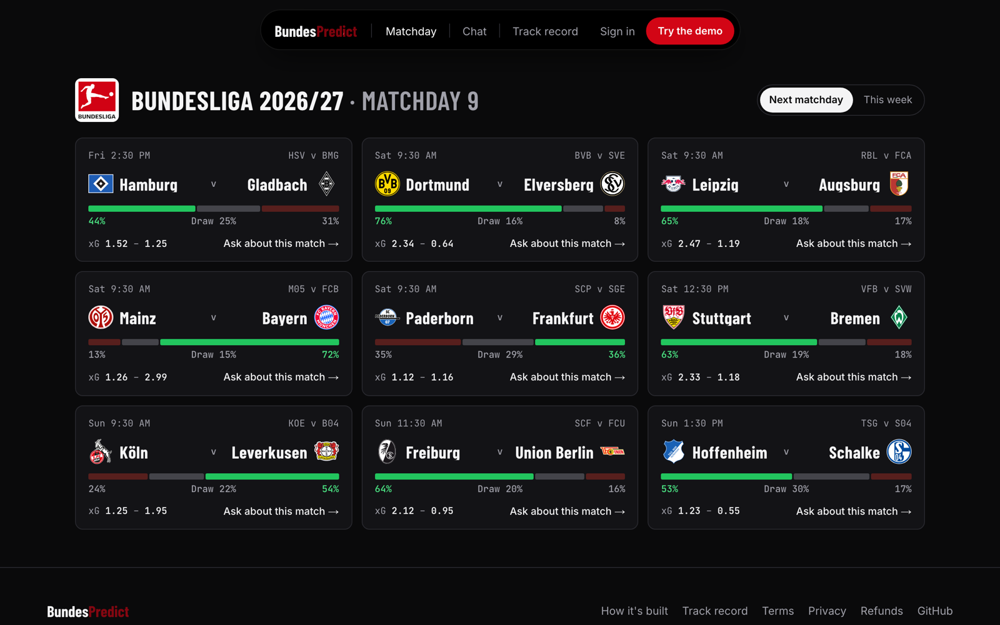
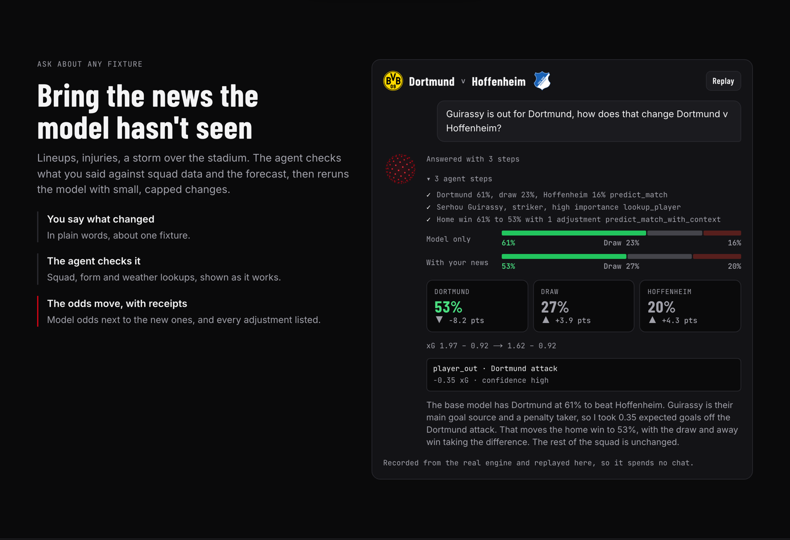
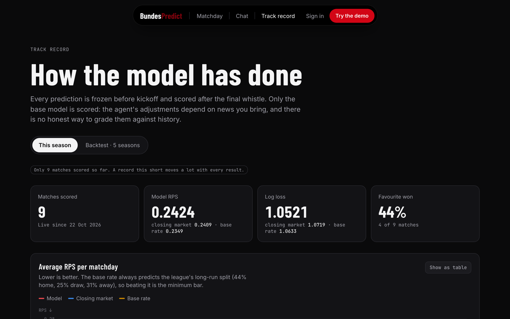

# BundesPredict

Win, draw and loss probabilities for every Bundesliga match, from a model I wrote, plus a chat agent you can tell the latest news to.

**Live at [bundespredict.egeyesilyurt.ca](https://bundespredict.egeyesilyurt.ca)**.
"Try the demo" on the landing page gets you in without signing up.



## What it is

BundesPredict is a website that predicts Bundesliga matches.
The numbers come from a Dixon-Coles model (a Poisson goals model with a small correction for low scores) fit on every Bundesliga result since 2020/21, and it refits every day.

The model only knows past results, so it has no idea that a striker got injured yesterday or that a storm is coming on Saturday.
That's what the chat is for.
You tell the agent what changed in plain words, it checks your claim against squad data and the weather forecast, and then it reruns the model with a small change to expected goals.
You get the model's odds and the new odds side by side, with every adjustment listed.

I kept a hard line between the two parts: the model does all the maths and the LLM only writes the explanation.
There is no tool the agent can use to set a probability.
It can only ask for an expected-goals change, and the server caps each one at ±0.6 xG no matter what it asked for.



## What's on the site

- **Matchday**: odds and expected goals for every fixture of the next matchday (or the next 7 days), public, no account needed.
- **Chat**: ask about one fixture and watch each agent step as it runs (player lookup, team form, weather, recent results, the prediction itself, etc.).
- **Track record**: every prediction is saved before kickoff and scored after the final whistle, next to the closing bookmaker odds and a base rate. Only the base model gets scored, since there's no honest way to grade the agent's adjustments against history.
- **Free and Pro**: sign in with Google or an emailed code. Free gets 3 chats a day, Pro is $5 CAD a month through Stripe for 100 chats a day and a matchday email every Thursday, and it has a few paying subscribers now.
- **Demo**: a throwaway account that lasts 24 hours, with a few chats already in it and a guided tour of the site.

## How good is it?

A little worse than the bookmakers, which is what I expected.
I backtested it walk-forward over five seasons (refit before every gameweek, using only results from before that round), 1,827 matches in total:

| Forecaster | RPS (lower is better) |
| --- | --- |
| Closing market | 0.1967 |
| Opening market | 0.1976 |
| **My model** | **0.2045** |

The closing line has a lot more information in it than a model that only looks at goals, so being this close to it tells me the model is sound.
It does not mean you can beat the bookies with it.
I also tried adding pre-match xG from Understat.
It fit the training data better but made the out-of-sample RPS worse (0.2069), so I left it out of the live model.

The full write-up is in [`reports/backtest_report.md`](reports/backtest_report.md).
Live results since 22 Oct 2026 are on the [track record page](https://bundespredict.egeyesilyurt.ca/track-record), but there are only a few matchdays so far, so those numbers still move a lot.



## How it's built

- **Frontend**: Next.js (App Router) and TypeScript, hosted on Vercel.
- **Backend**: Django REST Framework on Railway. Chat answers stream to the browser over SSE, and the agent runs on Claude through the Anthropic API.
- **Database**: Postgres on Neon. Every prediction is stored with the exact model run behind it.
- **Model**: a separate Python package (`packages/model`) with no database, network or LLM code inside, so it's easy to test on its own. The backend imports it.
- **Data**: results from football-data.co.uk, fixtures from OpenLigaDB, squads and market values from Transfermarkt, weather from Open-Meteo.
- **Other services**: Stripe for Pro, Resend for emails, Google for sign-in.
- **GitHub Actions**: CI on every PR, plus daily jobs that refit the model, save the day's predictions, score finished matches and delete expired demo accounts, and a weekly one that sends the matchday email.

```
packages/model/   the model, agent and backtest code (plain Python, no Django)
apps/backend/     Django REST API
apps/web/         Next.js site
infra/            Dockerfiles and docker-compose
```

## Run it locally

You need Docker, [uv](https://docs.astral.sh/uv/) and Node.

```bash
docker compose -f infra/docker-compose.yml up -d db   # Postgres on port 5433
uv sync
uv run apps/backend/manage.py migrate
uv run apps/backend/manage.py download_seasons --start 2020 --end 2026
uv run apps/backend/manage.py ingest_results
uv run apps/backend/manage.py refit --skip-download
uv run apps/backend/manage.py download_fixtures
uv run apps/backend/manage.py runserver 8001
```

Then the site, in a second terminal:

```bash
cd apps/web
printf "API_BASE_URL=http://localhost:8001\nPROXY_SECRET=dev-only-proxy-secret\n" > .env.local
npm install && npm run dev                             # http://localhost:3000
```

The chat needs an `ANTHROPIC_API_KEY` in `apps/backend/.env`; without one the chat endpoints answer 503 and everything else still works.
Tests run with `uv run pytest` (Docker has to be running, since they use a real Postgres) and `npm test` in `apps/web`.
